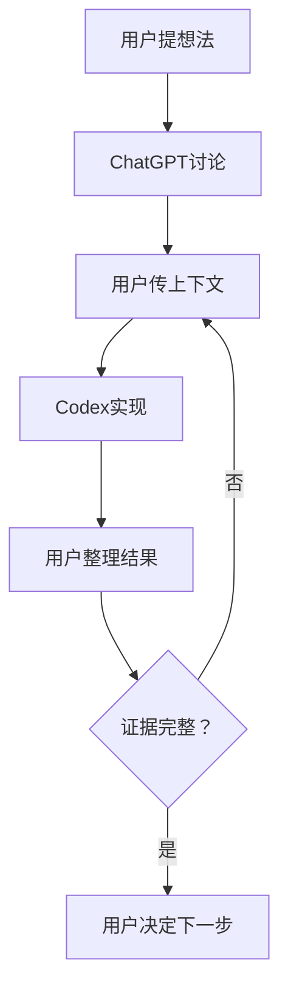
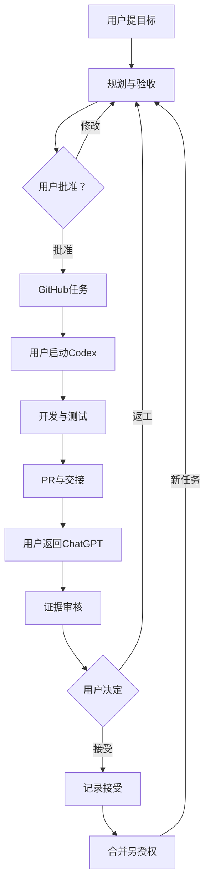

# 工作流与审核闭环

## 分工

用户决定目标、授权与接受结果。规划/审核端（ChatGPT 或 Gemini）负责规划、优先写 Issue、审查实际改动。执行端（Cloud Codex 或 Antigravity）在用户选择的仓库独立分支实施、测试、提交 PR 和交接记录。各方没有自动聊天共享或唤醒机制。

## 两种流程对比 / Workflow comparison

这是**无统一交接机制的典型手动示例**与**有真实权限、经用户授权的 AI Dev Handoff** 的说明性对比，不是对其他工具的必然断言，也没有实测性能数据。两图纵向排列，节点短句分行；手机可逐图阅读。图中只用中文短标签（以 ChatGPT / Codex 代表规划端与执行端）；每图下方保留完整中英文文字版。

These are illustrative scenarios, not universal claims or measured outcomes. Short Chinese labels run top to bottom; full equivalent Chinese and English text follows each diagram.

### 无统一交接 / Without structured handoff

文字版：用户提想法 → 规划端（ChatGPT / Gemini）讨论 → 用户传递上下文 → 执行端（Codex / Antigravity）实现 → 用户整理结果；证据不全则补上下文，证据齐全后用户判断下一步。其他手动流程也可能保留完整记录。

Text: idea → discussion → user copies context → implementation → user gathers results; fill gaps if evidence is incomplete, otherwise the user decides next. Other manual workflows may also keep complete records.

### 统一交接 / With AI Dev Handoff

文字版：目标 → 规划（ChatGPT / Gemini）→ 用户批准 → 持久任务 → 用户启动执行端（Cloud Codex / Antigravity）→ 实施测试 → PR/交接 → 用户返回规划/审核端 → 证据审核 → 用户决定；返工先批准修改范围，新任务重新规划。接受不自动合并。

Text: goal → plan (ChatGPT / Gemini) → user approval → durable task → user starts executor (Cloud Codex / Antigravity) → implementation/tests → PR/handoff → user returns to planner/reviewer → evidence review → user decision. Rework needs approved scope; new tasks return to planning. Acceptance does not merge a PR.

**没有统一交接机制时，用户常要兼任传话者与上下文整理者；有 AI Dev Handoff 后，用户仍掌握决策权，但规划、执行、记录和审核有了明确分工。**

**Without a structured handoff, the user often acts as messenger and context keeper. With AI Dev Handoff, the user remains in control while planning, execution, records and review have clear owners.**

权限与边界：规划/审核端（ChatGPT 或 Gemini）仅在有实际权限及授权时优先写 Issue；写不了则给完整任务。执行端（Codex 或 Antigravity）必须确认 Issue 可读，读不到用正文或版本化 `NEXT_TASK.md`，先保存批准任务再执行。图中的 GitHub 记录属于**用户自己的项目仓库**。每次切换由用户主动发起，没有聊天自动同步或自动唤醒。审核、用户接受、合并/部署/公开授权是不同决定；图中没有自动合并。

Permissions and boundaries: The planner/reviewer (ChatGPT or Gemini) prefers Issues only with actual write access and authorization; otherwise it supplies a full task. The executor (Cloud Codex or Antigravity) verifies Issue access and falls back to pasted content or versioned `NEXT_TASK.md`, saving the approved task before implementation. Records belong in **the user's own project repository**. Users initiate every switch; chats do not auto-sync or wake each other. Review, acceptance, and permission to merge/deploy/publish are separate decisions. No automatic merge is shown.

## 状态与证据

| 状态 | 谁推动、需要什么 |
| --- | --- |
| PLANNED | ChatGPT 或 Gemini 提出任务草案、范围与验收条件 |
| APPROVED | 用户明确同意范围；任务记录批准原文或可追溯消息摘要 |
| IN_PROGRESS | 用户启动 Codex 或 Antigravity；已读取任务和项目规范，已核验 `main` 状态并保存任务 |
| REVIEW | 执行端提交变更和证据、PR、Handoff，等待用户通知规划/审核端 |
| CHANGES_REQUESTED | 审核指出具体问题；用户确认返工范围后再交执行端 |
| ACCEPTED | 用户明确接受结果，保留审核与决定记录 |

正常流转：PLANNED → APPROVED → IN_PROGRESS → REVIEW → 用户决定 ACCEPTED 或 CHANGES_REQUESTED。返工批准后回 IN_PROGRESS。新需求回 PLANNED。任务文件是状态记录；Issue/PR 开关状态不等于业务验收。

## 任务持久化、增量上下文读取、状态防滞后与 MCP 读取降级

GitHub是项目记录的准绳。新会话或首次接手先读AGENTS.md、NEXT_TASK.md（如存在）、当前Issue/PR及评论，按需看上下文与代码；同会话续作与PR返工执行增量读取，不默认全仓重扫。规划/审核端在权限和授权允许时建仓/创建Issue并审核PR；执行端在独立分支实施、测试及交付。

**增量上下文读取（Incremental Context Loading）与四场景边界**：为避免同会话返工时无差别重扫全仓文档，同时杜绝沿用过期上下文（不作具体耗时或 Token 节省承诺），按场景分级读取：

| 场景 | 必须读取 / 核实 | 可直接复用（同会话未失效） | 触发重读（失效条件） |
| --- | --- | --- | --- |
| 1. 新会话 / 首次接手 | `AGENTS.md`、`NEXT_TASK.md`、当前 Issue/PR 及评论、两份默认 `SKILL.md` 全文；核实仓库、`main` ref、权限、工作区与合并状态；任务涉及的上下文/代码按需读取 | 无（跨会话不假设自动记忆） | 首次必读核心规范与当前任务 |
| 2. 同会话继续（小改/追问） | 新增用户指令、目标任务、当前分支/`HEAD`、相关远端状态、工作区变更、受影响文件与适用测试 | 本会话已读且未改动的 `AGENTS.md`、`SKILL.md`、未变动的背景文档 | 目标文件外部变更、需求跨模块扩展（需扩大读取范围并记录理由） |
| 3. PR 返工（同会话或续审） | 最新审核意见、上次已审提交到当前提交的增量 diff、受影响文件及关联测试（新提交必须重跑适用检查，不得沿用旧测试结果） | 同会话内未失效的规范、Skill 与未变动文件上下文 | 若开启了新会话，须先补齐场景 1 的规范与 Skill 读取 |
| 4. 上下文丢失或基线变化 | 重新核实最新 `origin/main`、变更后的规范/模板/代码及受影响依赖链 | 仅限已重新核验哈希/ref 未变的部分 | 远端 `main` 推进（如前序 PR 已合并）、范围/权限/安全边界变更、会话长对话压缩/截断或历史证据无法确认 |

**避免 `NEXT_TASK.md` 合并后滞后**：日常只更新 `NEXT_TASK.md` 六字段（当前状态、PR或分支、验证结果、未测项、下一步唯一任务、阻塞），详细需求、批准、测试输出和审核意见留 Issue/PR，仅里程碑归档 `docs/handoff/`。由于提交 PR 时 `NEXT_TASK.md` 记为 `REVIEW` 且禁止直接修改 `main`，PR 合并后 `main` 上的 `NEXT_TASK.md` 可能仍显示旧 PR 为 `REVIEW`。防滞后规则：1）每次接手核验时必须交叉对比 `main` 最新提交与 `NEXT_TASK.md` 所列 PR 的实际合并状态，发现已合并却仍标 `REVIEW` 时立即指出，以真实 `main` 为准；2）用户接受但尚未合并前，若需落盘 `ACCEPTED` 可在原 PR 分支更新后再合并；3）已合并产生滞后时，绝不直接向 `main` 提交，而是在下一轮独立功能分支的首个状态更新中一并收敛（或经用户明确批准单独提交状态修正 PR）。代码与实际需求文档照常修改，已有历史快照不改写。

**GitHub MCP 单文件读取缺陷与标准降级路径**：部分客户端（如 Gemini 接入 GitHub Remote MCP）调用 `get_file_contents` 读取单文件时可能仅返回 `successfully downloaded text file (SHA: ...)` 而无文本正文，且 `search_code` 返回 0 条并标记 `incomplete_results: true`。遇到此限制时：1）先用目录列举确认真实文件列表；2）调用 `get_commit(detail="full_patch")` 或 `pull_request_read(method="get_diff")` 读取近期提交或 PR 的完整 diff（新增或全量重写文件可 100% 还原全文）；3）对未在近期提交中全量改动的历史文件，局部 diff 无法一次还原整文件，必须明确报告受限文件与原因，回溯创建/全量修改提交或请用户提供全文，严禁猜测或伪称已读全文。

规划端不能写Issue或执行端不能读Issue时，用户提供完整任务；执行前保存在NEXT_TASK.md，再在PR补全详情，不能因减少文件丢失验收/批准证据。已有docs/tasks/仍可读取。无法推送时如实记录阻塞，不声称GitHub已有结果。

**Antigravity Project 绑定要求与 HTTP 403 补丁恢复闭环**：使用 Antigravity 作为执行端时，必须优先从已绑定目标 GitHub 仓库（Project Resources）的 **Project** 内发起开发会话，容器才会挂载该仓库的分支推送与建 PR 权限。若误在未挂载目标仓库的普通会话中完成开发、遇到 `git push` 返回 `HTTP 403` 时，无需重做开发，走已验证的无损恢复路径：1）在原会话保持独立分支本地提交完整，运行 `git format-patch` 导出补丁并计算 `sha256sum`，通过已授权的 Google Drive 工具上传补丁；2）在绑定了目标 GitHub 仓库的 Antigravity Project 会话中连接 Google Drive，下载补丁并校验 `sha256sum` 一致后，基于最新 `origin/main` 创建功能分支并用 `git am` 无冲突恢复原提交；3）更新 `NEXT_TASK.md` 为 `REVIEW`、重跑全套校验与隐私检查后推送分支并创建 PR。

## 审核实际变更

用户主动返回规划/审核端（ChatGPT 或 Gemini）提供一个PR链接。新会话先读取规范与批准范围，同会话在未失效前提下复用已读规范并重点读取实际/增量 diff（含通过 `pull_request_read(method="get_diff")` 获取完整补丁）及最新命令结果，逐条核验验收，区分建议与用户接受。无读取权限或遇到历史上下文缺失时，要求最少必要的完整快照并说明未核实部分，不能虚构通过。

用审核模板字段在PR记录问题和证据，返工批准后在原分支继续；NEXT_TASK.md只保留当前状态及唯一下一步。新提交不能自动沿用旧测试证据。审核、接受与合并/部署/发布/公开/删除分别决定；关键范围和数据决定也由用户确认，授权范围内可逆的日常实现可自行推进。禁止直接修改main或默认分支。
