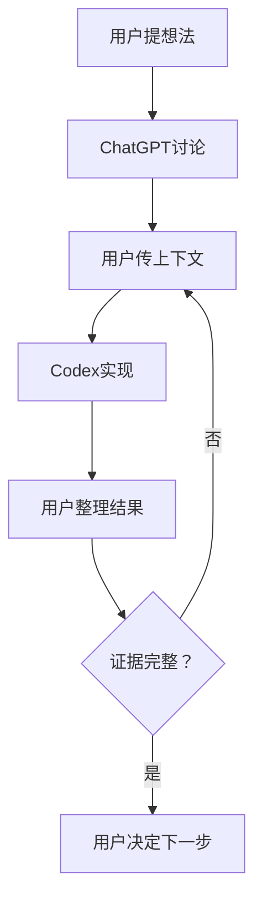
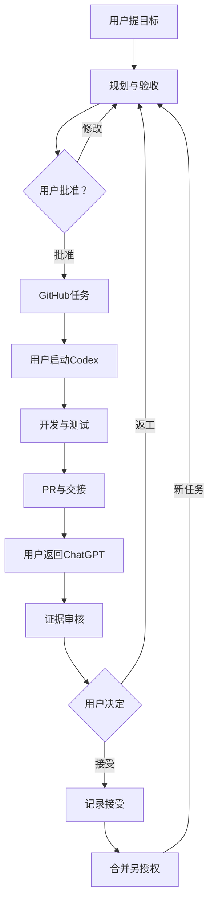

# 工作流与审核闭环

## 分工

用户决定目标、授权与接受结果。ChatGPT 规划、优先写 Issue、审查实际改动。Cloud Codex 在用户选择的仓库实施、测试、提交 PR 和 Handoff。三方没有自动聊天共享或唤醒机制。

## 两种流程对比 / Workflow comparison

这是**无统一交接机制的典型手动示例**与**有真实权限、经用户授权的 AI Dev Handoff** 的说明性对比，不是对其他工具的必然断言，也没有实测性能数据。两图纵向排列，节点短句分行；手机可逐图阅读。图中只用中文短标签；每图下方保留完整中英文文字版。

These are illustrative scenarios, not universal claims or measured outcomes. Short Chinese labels run top to bottom; full equivalent Chinese and English text follows each diagram.

### 无统一交接 / Without structured handoff

文字版：用户提想法 → ChatGPT讨论 → 用户传递上下文 → Codex实现 → 用户整理结果；证据不全则补上下文，证据齐全后用户判断下一步。其他手动流程也可能保留完整记录。

Text: idea → discussion → user copies context → implementation → user gathers results; fill gaps if evidence is incomplete, otherwise the user decides next. Other manual workflows may also keep complete records.

### 统一交接 / With AI Dev Handoff

文字版：目标 → 规划 → 用户批准 → 持久任务 → 用户启动 Codex → 实施测试 → PR/交接 → 用户返回 ChatGPT → 证据审核 → 用户决定；返工先批准修改范围，新任务重新规划。接受不自动合并。

Text: goal → plan → user approval → durable task → user starts Codex → implementation/tests → PR/handoff → user returns to ChatGPT → evidence review → user decision. Rework needs approved scope; new tasks return to planning. Acceptance does not merge a PR.

**没有统一交接机制时，用户常要兼任传话者与上下文整理者；有 AI Dev Handoff 后，用户仍掌握决策权，但规划、执行、记录和审核有了明确分工。**

**Without a structured handoff, the user often acts as messenger and context keeper. With AI Dev Handoff, the user remains in control while planning, execution, records and review have clear owners.**

权限与边界：ChatGPT仅在有实际权限及授权时优先写 Issue；写不了则给完整任务。Codex必须确认 Issue可读，读不到用正文或版本化 `NEXT_TASK.md`，先保存批准任务再执行。图中的 GitHub记录属于**用户自己的项目仓库**。每次切换由用户主动发起，没有聊天自动同步或自动唤醒。审核、用户接受、合并/部署/公开授权是不同决定；图中没有自动合并。

Permissions and boundaries: ChatGPT prefers Issues only with actual write access and authorization; otherwise it supplies a full task. Codex verifies Issue access and falls back to pasted content or versioned `NEXT_TASK.md`, saving the approved task before implementation. Records belong in **the user's own project repository**. Users initiate every switch; chats do not auto-sync or wake each other. Review, acceptance, and permission to merge/deploy/publish are separate decisions. No automatic merge is shown.

## 状态与证据

| 状态 | 谁推动、需要什么 |
| --- | --- |
| PLANNED | ChatGPT 提出任务草案、范围与验收条件 |
| APPROVED | 用户明确同意范围；任务记录批准原文或可追溯消息摘要 |
| IN_PROGRESS | 用户启动 Codex；已读取任务和项目规范，已保存任务 |
| REVIEW | Codex 提交变更和证据、PR、Handoff，等待用户通知 ChatGPT |
| CHANGES_REQUESTED | 审核指出具体问题；用户确认返工范围后再交 Codex |
| ACCEPTED | 用户明确接受结果，保留审核与决定记录 |

正常流转：PLANNED → APPROVED → IN_PROGRESS → REVIEW → 用户决定 ACCEPTED 或 CHANGES_REQUESTED。返工批准后回 IN_PROGRESS。新需求回 PLANNED。任务文件是状态记录；Issue/PR 开关状态不等于业务验收。

## 任务持久化与轻量交接

GitHub是项目记录的准绳。接手先读AGENTS.md、NEXT_TASK.md（如存在）、当前Issue/PR及评论，再看上下文与代码。ChatGPT在权限和授权允许时建仓/创建Issue并审核PR；Codex在独立分支实施、测试及交付。

日常只更新NEXT_TASK.md状态文件：当前状态、PR或分支、验证结果、未测项、下一步唯一任务、阻塞；详细需求、批准、测试输出和审核意见留Issue/PR。只有里程碑才归档docs/handoff/，不每轮另建任务/审核/交接文件。代码与实际需求文档照常修改，已有历史快照不改写。

ChatGPT不能写Issue或Codex不能读Issue时，用户提供完整任务；执行前保存在NEXT_TASK.md，再在PR补全详情，不能因减少文件丢失验收/批准证据。已有docs/tasks/仍可读取。无法推送时如实记录阻塞，不声称GitHub已有结果。

## 审核实际变更

用户主动返回ChatGPT提供一个PR链接。ChatGPT读取实际diff、批准范围及命令结果，逐条核验验收，区分建议与用户接受。无读取权限时要求最少必要的完整快照并说明未核实远端，不能虚构通过。

用审核模板字段在PR记录问题和证据，返工批准后在原分支继续；NEXT_TASK.md只保留当前状态及唯一下一步。新提交不能自动沿用旧测试证据。审核、接受与合并/部署/发布/公开/删除分别决定；关键范围和数据决定也由用户确认，授权范围内可逆的日常实现可自行推进。禁止直接修改main或默认分支。
